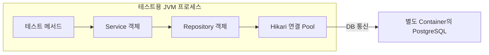

# 테스트 클래스, Spring Context와 DB 연결 Pool부터 이해하기

> 작성일: 2026-11-05
> 목적: 테스트 자원 종료 코드를 읽기 전에 필요한 용어와 실행 순서를 설명
> 예시는 개념 설명용이다. 새 Test 실행 결과나 새 운영 설정이 아니다.

## 1. 테스트 클래스와 테스트 메서드

테스트 클래스는 관련 검사들을 모아 둔 Java 클래스다. 그 안의 테스트 메서드는 각각 검사 한 가지를 수행한다. 아래는 구조를 보여주는 가상 축약 예시다.

```java
class ExampleTicketIntegrationTest {
    @Test
    void 문의를_저장할_수_있다() {
        // 검사 A: 문의를 저장하고 DB Row를 확인
    }

    @Test
    void 다른_고객의_문의는_조회할_수_없다() {
        // 검사 B: 권한 없는 조회가 거부되는지 확인
    }
}
```

클래스는 한 개이고 테스트 메서드는 두 개다. A가 끝났어도 B가 남아 있다면 이 클래스의 모든 검사가 끝난 것은 아니다. 여기서 A/B는 범위를 설명하기 위한 이름이며 실제 JUnit의 메서드 실행 순서를 지정한 예시는 아니다.

## 2. 검사를 실행할 때 어떤 프로그램이 움직이나

Maven으로 테스트를 실행하면 이 프로젝트에서는 테스트용 JVM 프로세스가 Java 테스트를 실행한다. 그 JVM의 메모리에 테스트 코드와 테스트가 사용하는 객체들이 생긴다. 테스트 PostgreSQL은 별도 Docker Container에서 실행된다.

이 통합 테스트에서는 Spring도 테스트용 JVM 안에 필요한 객체들을 준비한다. HTTP 검사는 MockMvc를 사용하므로, 이 설명을 운영 AWS 서버나 외부 공개 HTTP 서버가 새로 시작됐다는 뜻으로 읽지 않는다.



그림의 화살표는 호출/DB 사용 흐름이다. Spring Context가 이 JVM 안에서 Service, Repository와 DataSource 같은 객체를 생성하고 관리한다. DB Container 자체는 별도로 관리한다.

## 3. Spring Context는 무엇인가

ApplicationContext는 Spring의 객체 관리 기능을 제공하는 객체다. Spring이 생성하고 관리하는 객체를 Bean이라고 부른다. 이 프로젝트의 Service, Repository와 DataSource 등이 여기에 해당한다.

예를 들어 문의 저장 Service가 Repository를 필요로 하면 Spring이 둘을 준비하고 필요한 참조를 연결한다. 테스트가 Service를 호출하면 미리 연결된 Repository와 DB 연결 관리 기능을 사용할 수 있다.

Context를 생성하는 일에는 여러 객체를 준비하는 비용이 든다. 그래서 Spring Test는 같은 설정의 Context를 캐시에 보관해 재사용할 수 있다. 캐시는 여기서 객체를 다시 쓰기 위해 메모리에 보관하는 기능이다. 문의 Row를 보관하는 PostgreSQL과는 역할이 다르다. [Spring Context 캐시](https://docs.spring.io/spring-framework/reference/testing/testcontext-framework/ctx-management/caching.html)

Context가 닫혔다고 관련 Java 객체의 메모리가 그 순간 모두 지워졌다는 뜻도 아니다. 종료 처리를 수행하고 더 이상 사용하지 않는 객체의 참조가 없어지면 JVM의 메모리 회수 대상이 될 수 있다.

## 4. DB 연결 Pool은 왜 필요한가

SQL을 실행하려면 Java 프로그램이 PostgreSQL과 통신할 연결이 필요하다. 매번 새 연결을 만들고 인증하는 대신, 여러 연결을 준비해 빌려주고 반납받으며 재사용할 수 있다. 이 연결들을 관리하는 기능이 연결 Pool이다.

HikariCP는 그 기능을 제공하는 라이브러리다. DataSource는 코드가 DB 연결을 요청하는 표준 인터페이스이고, 이 프로젝트에서는 HikariDataSource 객체가 연결을 제공하며 Pool을 관리한다.

```text
Repository가 연결 요청
  -> Pool에서 연결을 빌림
  -> 그 연결로 SQL 실행
  -> 사용한 연결 반납
  -> 다음 작업에서 재사용
```

빌린 연결 한 개를 반납하는 것과 Pool 전체를 닫는 것은 다르다.

| 동작 | Hikari를 사용하는 이 구성에서의 의미 |
|---|---|
| 빌린 Connection의 close | 보통 연결을 Pool에 반납. 손상/퇴출 조건의 연결은 폐기될 수 있음 |
| HikariDataSource의 close | DataSource와 관련 Pool 전체를 종료 |

반납 과정에 미완료 Transaction이 있으면 정리 동작이 개입할 수 있다. 이것을 이미 Commit된 다른 Transaction의 데이터를 되돌리는 것으로 해석하지 않는다. [Hikari 연결 반납 코드](https://github.com/brettwooldridge/HikariCP/blob/HikariCP-7.0.2/src/main/java/com/zaxxer/hikari/pool/ProxyConnection.java), [DataSource 종료 코드](https://github.com/brettwooldridge/HikariCP/blob/HikariCP-7.0.2/src/main/java/com/zaxxer/hikari/HikariDataSource.java)

## 5. 왜 테스트 한 개가 끝났을 때 바로 닫지 않나

앞의 A와 B가 같은 Context와 Pool을 재사용한다고 가정하자. A가 끝났을 때 Pool 전체를 닫으면 B가 그 Pool에서 새 DB 연결을 빌릴 수 없다. 계속 사용하려면 필요한 자원을 새로 준비해야 한다.

이번 설정은 한 클래스 안에서 재사용하고 클래스가 끝날 때 Context를 정리한다.

```text
같은 클래스의 검사 A와 B가 Context/Pool 사용
  -> 클래스의 검사들이 끝남
  -> Context를 캐시에서 제거하고 닫음
  -> Context가 관리하던 Pool도 정리
```

이 시점을 지정한 Annotation이 다음 코드다.

```java
@DirtiesContext(classMode = DirtiesContext.ClassMode.AFTER_CLASS)
```

AFTER_CLASS는 클래스가 끝난 뒤라는 뜻이다. 테스트 메서드 하나가 끝날 때마다라는 뜻이 아니다. 다른 메서드별 종료 설정이 없는 현재 구성의 설명이며, 모든 테스트에 이 Annotation을 붙여야 한다는 보편 규칙도 아니다. [Spring DirtiesContext](https://docs.spring.io/spring-framework/reference/testing/annotations/integration-spring/annotation-dirtiescontext.html)

별도 Testcontainers 확장도 클래스가 소유하는 DB Container를 정리한다. 이 Annotation만으로 모든 확장의 종료 Callback 순서를 보장한다고 설명하지 않는다.

## 6. Thread는 왜 나오는가

Thread는 프로세스 안에서 코드를 실행하는 흐름이다. 하나의 JVM 프로세스 안에서도 여러 Thread가 동작할 수 있다. 메모리에 Pool 객체가 존재하는 것과, 그 Pool의 관리 코드를 실행하는 Thread가 움직이는 것은 구분한다. [Java 25 Thread 설명](https://docs.oracle.com/en/java/javase/25/docs/api/java.base/java/lang/Thread.html)

### 이 프로젝트에서 검사하는 Thread

Hikari는 연결 준비나 주기적인 관리 작업을 위해 실행기를 사용한다. 라이브러리의 기본 구성에는 다음과 같은 역할이 있다. 이름은 7.0.2 소스에 있는 예시이며 오늘 새로 관찰한 Thread 목록이 아니다.

| 이름의 예 | 역할 |
|---|---|
| Pool이름:housekeeper | 주기적으로 연결 유지/정리 작업 수행 |
| Pool이름:connection-adder | 필요한 DB 연결을 추가하는 작업 수행 |
| Pool이름:connection-closer | 연결 종료 작업 수행 |

여기의 검사는 해당 Pool 이름으로 식별한 관리 Thread를 대상으로 한다. 모든 JVM Thread를 검사하는 것은 아니다. [HikariPool의 실행기/종료 소스](https://github.com/brettwooldridge/HikariCP/blob/HikariCP-7.0.2/src/main/java/com/zaxxer/hikari/pool/HikariPool.java)

### Thread도 재사용할 수 있다

하나의 작업이 끝날 때마다 Thread를 반드시 종료하는 것은 아니다. 살아 있는 작업 Thread가 작업을 실행하고, 다음 작업을 기다렸다가 다시 실행하는 재사용이 가능하다. 이를 관리하는 Thread Pool도 있다. [Java ThreadPoolExecutor 설명](https://docs.oracle.com/en/java/javase/25/docs/api/java.base/java/util/concurrent/ThreadPoolExecutor.html)

```text
같은 관리 Thread가 점검 실행
  -> 다음 실행 때까지 대기
  -> 다시 점검 실행
```

따라서 같은 Pool을 쓰는 다음 테스트가 남아 있다면 그 관리 Thread도 계속 사용할 수 있다. Pool 재사용과 Thread 재사용이 서로 반대되는 규칙은 아니다.

| Pool의 종류 | 재사용하는 대상 |
|---|---|
| DB 연결 Pool | DB 연결 |
| Thread Pool | 여러 작업을 실행할 살아 있는 작업 Thread |

여기서 재사용은 아직 종료되지 않은 Thread가 여러 작업을 실행한다는 뜻이다. 이미 종료된 동일 Thread를 다시 start하는 것은 불가능하다. [Thread.start의 계약](https://docs.oracle.com/en/java/javase/25/docs/api/java.base/java/lang/Thread.html#start())

### 그러면 언제 정리하나

이번 테스트는 클래스별로 독립된 Context/Pool/DB를 사용한다. 클래스가 끝나 Pool A의 사용을 마쳤다면, Pool A를 계속 관리할 작업도 끝내고 그 실행기를 정리한다. 다음 테스트의 새 Pool B가 이전 Pool A의 관리 Thread를 자동으로 물려받는 구조는 아니다.

사용이 끝난 자원을 관리하는 Thread를 방치하면 스택 등 자원과 객체 참조가 불필요하게 남거나, 끝난 DB를 향한 작업이 이어질 수 있다. 종료 처리에서 정리를 기다리는 상황도 생길 수 있다. 모든 살아 있는 Thread가 항상 CPU를 사용하거나 JVM 종료를 막는다는 뜻은 아니다.

Pool 종료는 Hikari의 종료 기능에 맡기고, 우리의 Verifier는 정리가 끝났는지 확인한다. Thread를 무조건 강제 종료해 검사를 통과시키는 코드가 아니다. 실행 흐름의 종료와 Java 객체 메모리의 즉시 제거도 같은 뜻이 아니다.

여러 Pool이 실행기를 공유하도록 설계할 수도 있다. 그 경우 공유 실행기의 소유자가 전체 사용 기간에 맞춰 종료를 책임져야 한다. Hikari도 외부에서 제공한 주기 실행기는 자신이 만든 실행기와 구분한다. 현재 클래스별 독립 Fixture를 그런 공유 구조로 바꾼 것은 아니다.

따라서 업무 검사 결과와 별도로, 사용 기간이 끝난 Context/Pool 및 그 범위에 속한 관리 Thread의 정리를 확인한다.

## 7. isClosed가 true인데 왜 별도 검사를 하나

isClosed는 HikariDataSource가 종료 상태로 표시됐는지 확인하는 메서드다. HikariCP 7.0.2 소스에서는 종료 상태를 먼저 true로 바꾸고 Pool 종료를 수행한다. isClosed는 그 상태 값을 읽는다. 그러므로 그 값 하나를 모든 관련 작업과 프로세스가 종료됐다는 증거로 확대하지 않는다. [HikariDataSource의 close/isClosed](https://github.com/brettwooldridge/HikariCP/blob/HikariCP-7.0.2/src/main/java/com/zaxxer/hikari/HikariDataSource.java)

아래는 Pool 부분만 설명하는 가상 예시이며 새 실행 결과가 아니다. isClosed가 두 장면에서 모두 true여도 관리 Thread가 남아 있는지는 다를 수 있다.

| 장면 | isClosed | 해당 Pool의 살아 있는 관리 Thread | 판단 |
|---|---|---|---|
| 종료 상태를 표시했고 정리 작업이 남음 | true | 1개 | Thread 정리 완료로 판정할 수 없음 |
| 해당 관리 Thread도 종료됨 | true | 0개 | 이 Pool의 Thread 수 조건은 충족. Context나 전체 JVM 종료는 별도 확인 |

실제 Verifier는 다음 조건을 각각 확인한다.

1. 사용하던 Context가 비활성 상태인지 확인한다.
2. 사용하던 HikariDataSource의 isClosed가 true인지 확인한다.
3. 해당 Pool 이름으로 식별한 관리 Thread가 0개인지 확인한다. 정리가 끝나도록 최대 2초 기다린다.

세 번째 조건까지 통과해야 이번 자원 검사 전체가 통과한다. 이 검사가 모든 OS 프로세스나 모든 종류의 Thread까지 조사한 것은 아니다. 테스트용 JVM 전체가 끝났는지는 별도 관찰 근거다.

실제 코드에서는 검사 전에 쓰던 객체의 참조를 보관했다가 그 객체를 확인한다. 새 객체를 만들어 검사해도 예전 객체의 정리를 증명할 수 없기 때문이다. 이 Listener의 코드는 기초 개념을 익힌 뒤 [실제 코드 설명](./test-jvm-resource-lifecycle.md#실제-코드에서-객체와-시점을-연결하기)에서 읽는다.

## 8. DB 연결 종료와 저장 데이터의 관계

Pool은 Java 프로그램 쪽의 연결 관리 자원이다. Commit된 Ticket Row는 PostgreSQL에 저장된 데이터다. 저장 위치와 수명이 다르다.

Pool을 닫는 동작 자체는 이미 Commit된 문의를 DELETE하거나 Rollback하는 업무 명령이 아니다. 별도로 테스트 DB Container를 폐기하거나 데이터를 지우는 Fixture 정리는 다른 동작이다. 실제 운영 데이터 보존과 임시 테스트 DB의 폐기를 혼동하지 않는다.

| 확인한 사실 | 그 사실로 설명할 수 있는 범위 |
|---|---|
| 문의 저장/권한 등의 검사 통과 | 그 업무 사례가 기대대로 동작했음 |
| 사용한 Context/Pool/식별한 Thread 정리 확인 | 그 범위의 테스트 자원이 정리됐음 |
| 테스트 JVM 종료 관찰 | 그 JVM 프로세스가 끝났음 |

한 항목의 성공으로 다른 항목을 자동 판정하지 않는다.

## 읽은 뒤 처음 확인할 두 가지

1. 같은 클래스의 검사 B도 같은 Pool을 쓸 예정인데 A가 끝난 직후 Pool 전체를 닫는 것이 적절한가?
2. Pool 전체를 닫으면 PostgreSQL에 이미 Commit된 Ticket Row도 삭제되는가?

이 두 가지를 먼저 확인한 뒤 Context 상태/Thread 수와 실제 Listener 조건식을 읽는다. 실제 답변과 학습 진행은 해당 날짜의 학습 기록에 별도로 남긴다.
