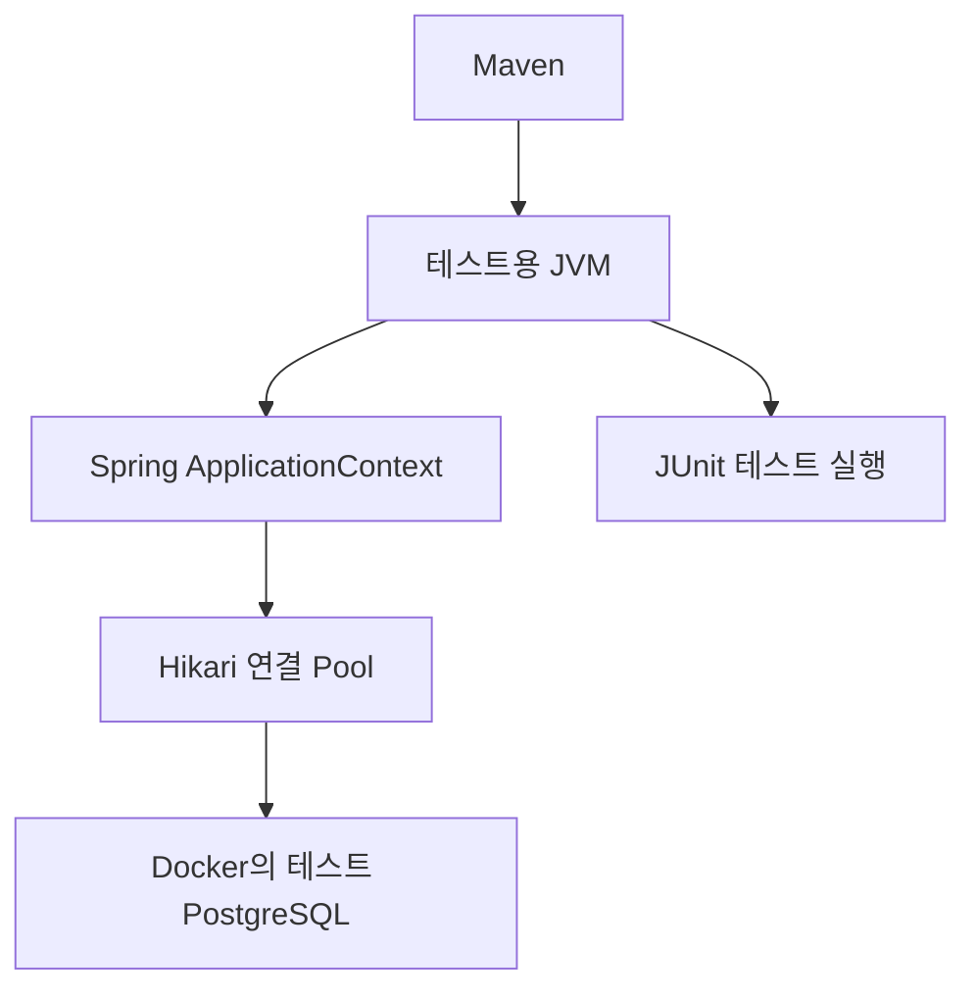

# 테스트 통과와 JVM 종료를 구분하기

> 기준: 2026-11-04 로컬 Java/PostgreSQL 검증
> 실제 실행 근거: [테스트 자원 정리 보고서](../lab-reports/2026-11-04-test-jvm-cleanup.md)

## 테스트가 끝났는데 왜 프로세스가 남았나

테스트 메서드의 검사가 끝나는 것과 그 테스트가 사용한 자원을 정리하는 것은 다른 단계다. 이번에는 문의 저장이나 확인 범위의 검사가 통과한 뒤, 테스트 JVM 종료 과정에서 Spring이 Hikari 연결 Pool을 닫기를 기다리는 상황이 이전 Dump에 남아 있었다.



Hikari Pool은 DB 연결을 재사용하기 위한 객체와 관리 Thread를 보관한다. 업무 검사가 끝났어도 Pool이 열려 있으면 그 자원이 남아 있을 수 있다. 테스트용 JVM도 종료 Hook의 정리를 마쳐야 정상적으로 끝날 수 있다.

이번 Surefire 설정의 종료 유예는 30초다. 유예를 넘겨 강제로 끝났다는 경고는 업무 검사의 실패와는 구분해야 하지만, 정상적인 자원 정리의 증거로 받아들여서도 안 된다. 이 설정을 늘려 경고만 피하는 대신 실제로 기다린 지점을 먼저 확인했다. [Surefire 3.5.5 종료 설명](https://maven.apache.org/surefire-archives/surefire-3.5.5/maven-surefire-plugin/examples/shutdown.html)

## 두 자원의 수명이 달랐다

일부 통합 테스트는 한 클래스가 자기 PostgreSQL Container를 소유한다. JUnit의 Testcontainers 확장은 클래스 경계에서 그 Container를 종료한다. 반면 Spring Test는 같은 설정을 재사용하려고 ApplicationContext를 캐시에 보관할 수 있다. 테스트 메서드나 클래스가 끝났다는 사실만으로 Context도 즉시 닫힌다고 볼 수 없다. [Spring Context 캐시](https://docs.spring.io/spring-framework/reference/testing/testcontext-framework/ctx-management/caching.html)

그 결과 DB의 수명은 끝났는데 그 DB에 연결하던 Context/Pool은 남는 구성이 될 수 있었다. 이전 두 Dump에는 JVM 종료가 Spring의 종료 Hook을 거쳐 Hikari Pool의 실행기 종료를 기다리는 경로와 남은 연결 생성 Thread가 있었다. 이것이 이번에 확인한 대기 경로다. 모든 종료 지연이 같은 원인이라고 일반화하지 않는다.

## 이번에 선택한 정리 방식

해당 기본 통합 테스트 21개에 다음 설정을 적용했다.

```java
@Testcontainers
@DirtiesContext(classMode = DirtiesContext.ClassMode.AFTER_CLASS)
```

한 클래스 안에서는 Context를 재사용하고 클래스가 끝나면 캐시에서 제거하고 닫는다. 다음 클래스가 필요로 하는 Context는 다시 준비한다. 이 설정이 운영 문의를 삭제하거나 업무 Transaction을 Rollback하는 것은 아니다. [DirtiesContext의 의미](https://docs.spring.io/spring-framework/reference/testing/annotations/integration-spring/annotation-dirtiescontext.html)

모든 테스트에 이 설정을 붙이는 보편 규칙은 아니다. 이번에는 클래스별로 독립 DB를 이미 사용하고 있어 그 수명에 맞췄다. 모든 클래스가 공유하는 DB로 바꾸면 격리 방식이 달라진다. Container를 Spring Bean으로 관리하면 의존 Bean과 종료 순서를 맞출 수 있지만 더 넓은 Fixture 변경이 필요하다. 이번 Annotation이 JUnit의 모든 종료 Callback 순서까지 보장한다고 설명해서도 안 된다. [Spring Boot의 Container 수명 관리](https://docs.spring.io/spring-boot/reference/testing/testcontainers.html)

## 무엇을 실제로 확인했나

대표 3개 클래스에는 설정 유무가 아닌 실제 자원을 검사하는 TestExecutionListener도 연결했다. 기존 Context와 DataSource 참조를 보관한 뒤 클래스 종료 Callback에서 다음을 검사한다.

1. Context가 비활성 상태인가?
2. HikariDataSource가 닫혔는가?
3. 해당 Pool의 이름으로 식별한 살아 있는 관리 Thread가 0개인가?

세 번째 검사는 최대 2초 동안 정리가 끝나는지 관찰한다. Thread를 강제로 종료하지 않고, 모든 OS 프로세스나 DB 자원을 검사하는 것도 아니다. `isClosed()` 하나와 전체 프로세스 종료를 같은 증거로 취급하지 않는다.

| 실행 | 관찰 |
|---|---|
| 기존 대표 3개 클래스 | 업무 테스트 60건 통과. 클래스 경계에서 Context/Pool이 닫혔다는 근거는 없음 |
| 새 정리 검사만 추가 | 기존 60건 외 클래스 종료 Callback 3곳에서 오류. 아직 열려 있는 Context/Pool을 실제로 탐지 |
| 클래스 종료 시 Context 정리 적용 | 같은 60건과 대표 3곳의 자원 검사 통과 |
| 해당 패턴 21개에 적용한 전체 verify | Surefire 1,173건, Failsafe 2건 통과. 이번 실행의 종료 제한 경고/새 Dump 0건 |

전체 실행이 끝난 뒤 Lab 소유 Surefire JVM도 0개였다. 이 결과는 이번 로컬 테스트 환경의 정리 근거다. 운영 서버의 SIGTERM 처리, 진행 중 AI 요청의 중단 정책이나 실제 AWS Task 종료를 이번에 검증한 것은 아니다.

## 읽고 구분할 핵심

- 업무 검증: 문의, 답변, 확인 이력이 합의한 계약대로 저장/거부됐는가?
- 자원 정리 검증: 그 실행에서 사용한 Context, 연결 Pool과 관련 Thread가 끝났는가?
- 프로세스 종료 관찰: 전체 테스트 JVM이 종료 제한 경고 없이 끝났는가?

세 결과를 각각 기록한다. 테스트가 통과했다는 한 문장으로 마지막 두 단계까지 확인했다고 적지 않는다. 반대로 테스트 프로세스의 정리 지연만으로 이미 Commit된 업무 데이터가 잘못됐다고 단정하지도 않는다.
